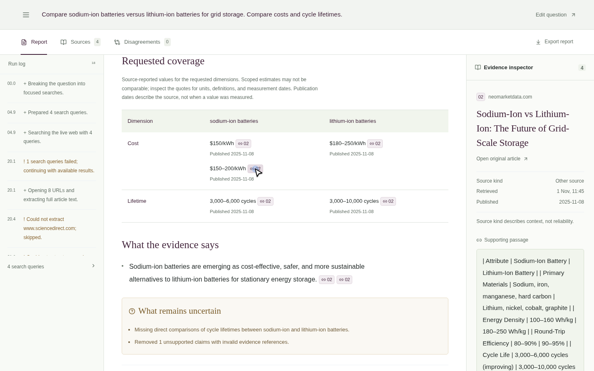

# Veriweb

Research answers with the sources still attached.

Veriweb searches the web, reads full articles, and turns the relevant passages into a report you can inspect. Numeric comparisons come with their original units and citations. When sources give different figures, the disagreement view puts their quotations side by side. Missing evidence stays visible.

Built for AMD AI League, Match 4: Intelligent Web Information Retrieval.



## What it does

- Breaks a question into focused searches and reads up to eight accessible pages.
- Combines BM25 ranking with optional vector embeddings to select relevant passages.
- Builds a comparison table for the requested subjects, metrics, years, and scopes.
- Opens exact source quotations beside the report and links to the original pages.
- Flags candidate disagreements without treating every difference as a contradiction.
- Saves reports locally and exports Markdown with quotations and source links.

A matching quotation establishes provenance, not the truth of a publisher's claim. The model can still misunderstand evidence; the interface keeps the original context available for review.

## Run locally

Requires Python 3.12+ and Node.js 24. On an AMD machine with ROCm PyTorch already installed, reuse that installation:

```sh
python -m venv --system-site-packages .venv
.venv/bin/python -m pip install -e '.[dev]'
npm --prefix web ci
cp .env.example .env
.venv/bin/python scripts/dev.py
```

Open the URL printed by the launcher. Without a model, select **Evidence only** to search, extract, and rank source text. Full report generation needs a compatible model endpoint.

See [model and AMD setup](docs/setup.md) for local Qwen inference, embeddings, and the optional container profiles. Model weights are downloaded explicitly and are not included in this repository.

After configuring a local GGUF model:

```sh
.venv/bin/python scripts/dev.py --with-model
```

For a production frontend build:

```sh
npm --prefix web run build
.venv/bin/python scripts/dev.py --with-model --production
```

## CLI

```sh
.venv/bin/python app.py   --query "What is Mercury orbital period in Earth days?"   --url https://science.nasa.gov/mercury/facts/   --query-id mercury
```

The CLI writes `output/_output.json` with the answer, citations, confidence, conflict flag, and runtime telemetry. It also accepts saved HTML through `--corpus`. Missing or ambiguous evidence produces an empty answer. A supervised worker bounds the default query execution to a 25-second budget.

The full dashboard investigation can take longer; its report and synthesis are separate from the exact-answer CLI. See [the CLI reference](docs/cli.md).

## AMD execution

The local demo ran Qwen2.5-3B-Instruct Q4_K_M through llama.cpp Vulkan on an AMD Radeon RX 6500M with 4GB VRAM, alongside a Ryzen 5 5600H. Embeddings ran on the CPU to leave GPU memory for generation.

A single standalone generation measured 36.7 decode tokens/second, with about 2.14 GiB of total discrete-GPU memory in use. The live battery investigation measured 20.9 generation tokens/second and 32.7 seconds of retrieval. These are different measurements, not interchangeable throughput claims.

A separate ROCm PyTorch FP16 operation was verified. Native ROCm LLM generation and the AMD candidate container have not been verified. [Recorded hardware measurements](evals/results/hardware.json).

## Tests and evaluation

```sh
.venv/bin/python -m pytest -q
.venv/bin/ruff check backend scripts app.py
.venv/bin/mypy backend/veriweb scripts app.py
npm --prefix web test
npm --prefix web run lint
npm --prefix web run typecheck
npm --prefix web run build
```

The latest recorded checks passed 102 backend tests and 15 frontend tests. The two research evaluation sets passed 20/20 cases each using actual local model inference. They are controlled synthetic regression sets, not a claim of broad live-web accuracy. [Evaluation commands, results, and scoring limits](docs/evaluation.md).

## Project layout

| Path | Purpose |
| --- | --- |
| `backend/veriweb/` | Retrieval, evidence validation, synthesis, and API |
| `web/` | Next.js research dashboard |
| `app.py` | Bounded JSON CLI |
| `scripts/` | Local services, model setup, diagnostics, and evaluation |
| `evals/` | Synthetic fixtures and recorded scores |
| `docs/` | Setup, CLI, and evaluation references |

Search uses keyless DDGS by default, with optional Tavily support. Extraction uses Trafilatura. Models connect through a chat-completions endpoint with structured output. Source fetching checks public addresses, redirects, robots rules, timeouts, and response sizes.

The dashboard is intended for a local workspace. Public multi-user hosting needs authentication, per-user storage, and rate limits. Secrets belong in `.env`, which is ignored. Bundled Inter and Gloock fonts retain their licenses in `web/public/fonts/`.
